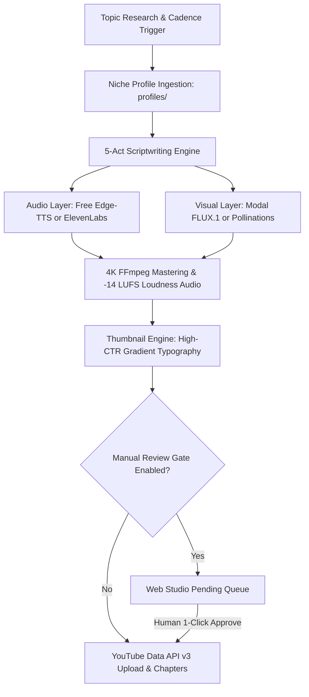

<div align="center">

# 🎬 SchemaStudio

**The Open-Source, Self-Hosted Autonomous 4K YouTube Production Pipeline**<br/>
*From deep-dive research to 5-act scriptwriting, neural voiceovers, FLUX visuals, 4K mastering, and YouTube Cloud upload.*

[](LICENSE)
[](https://www.python.org/)
[-ff69b4?style=flat-square&logo=microsoft&logoColor=white)](https://github.com/rany2/edge-tts)
[](https://modal.com)
[](http://localhost:8000)
[](https://paypal.me/mhksandhu)
[](https://buymeacoffee.com/mehaksandhudev)
[](https://github.com/mehaksandhudev/SchemaStudio)

An autonomous, multi-channel video production workstation for developers, creators, and media labs.<br/>
Built to run **100% free out-of-the-box** using open models and neural speech, with instant zero-code upgrades to ElevenLabs and Modal GPU when API keys are provided.

[Live Web Studio](#-web-studio-pro-ui) • [Quick Start](#-quick-start) • [Niche Profiles](#-built-in-niche-profiles) • [Support](#-support) • [Contributing](#-contributing)

</div>

---

## 📑 Table of Contents

- [✨ Key Capabilities](#-key-capabilities)
- [🏗️ Architecture Pipeline](#-architecture-pipeline)
- [⚡ Quick Start](#-quick-start)
- [🎨 Built-In Niche Profiles](#-built-in-niche-profiles)
- [🖥️ Web Studio Pro UI](#-web-studio-pro-ui)
- [🔐 Universal YouTube OAuth2 Setup](#-universal-youtube-oauth2-setup)
- [🛡️ Zero-Cost Guarantees & Fallbacks](#-zero-cost-guarantees--fallbacks)
- [☕ Support](#-support)
- [🤝 Contributing](#-contributing)
- [📜 License](#-license)

---

## ✨ Key Capabilities

- **100% Free Out-of-the-Box**: Uses Microsoft Edge-TTS neural speech (`en-US-ChristopherNeural`, `en-US-GuyNeural`) and Pollinations FLUX for image generation. Never hard-crashes without paid API keys.
- **Dynamic Multi-Channel Architecture**: Brand identity, channel handles, tags, and privacy policies cleanly decouple into `channel.json` and `profiles/`.
- **Pre-Tuned Niche Profiles**: Switch from **Psychology** to **Tech Engineering**, **History**, **Finance**, or **Sci-Fi** with one click.
- **Production-Grade 4K Video Mastering**: FFmpeg-powered Ken Burns pan/zoom camera motion, ambient soundtrack ducking, and YouTube-standard **-14 LUFS loudness normalization**.
- **Human-in-the-Loop Review Gate**: Run fully hands-off on scheduled autopilot, or require one-click human approval before pushing to YouTube Cloud.
- **Universal OAuth2 Integration**: Plug-and-play authentication via Google Cloud credentials with dynamic port handling to avoid local collisions.

---

## 🏗️ Architecture Pipeline



---

## ⚡ Quick Start

### 1. Clone & Setup Environment

```bash
git clone https://github.com/mehaksandhudev/SchemaStudio.git
cd SchemaStudio

python -m venv .venv

# Windows:
.venv\Scripts\activate
# Linux/macOS:
source .venv/bin/activate

pip install -r requirements.txt
```

### 2. Configure Your Channel

Copy the environment template and customize `channel.json`:

```bash
cp .env.example .env
```

```json
{
  "channel_name": "My YouTube Channel",
  "channel_handle": "@MyChannel",
  "active_profile": "default_psychology",
  "upload_privacy": "private",
  "autopilot_cadence_days": 1,
  "require_manual_review": true
}
```

> **Note**: `upload_privacy` defaults to `private` for safety, ensuring no unreviewed videos go live without your explicit approval.

### 3. Launch Web Studio Dashboard

```bash
python dashboard/server.py
```

Open your browser to **http://localhost:8000**.

### 4. Run Production from Command Line (Optional)

```bash
# Produce a video on a custom topic using the active profile
python -m pipeline.orchestrator "The Silent Architecture of Habit Loops"

# Trigger daily autonomous autopilot cycle
python -m pipeline.daily_job
```

---

## 🎨 Built-In Niche Profiles

All profile definitions live in [`profiles/`](profiles/) as clean, human-editable YAML files:

| Profile File | Niche Domain | Art Style | Voice Archetype |
| :--- | :--- | :--- | :--- |
| [`default_psychology.yaml`](profiles/default_psychology.yaml) | Human Behavior & Mindset | 2D minimalist charcoal sketch | `en-US-ChristopherNeural` (Introspective) |
| [`tech_documentary.yaml`](profiles/tech_documentary.yaml) | Engineering & Deep Systems | Isometric blueprints & schematics | `en-US-GuyNeural` / Brian (Authoritative) |
| [`history_deepdive.yaml`](profiles/history_deepdive.yaml) | Epic Epochs & Turning Points | Baroque chiaroscuro oil painting | `en-US-RyanNeural` (Dramatic) |
| [`finance_crypto.yaml`](profiles/finance_crypto.yaml) | Market Regimes & Liquidity | Glassmorphic vector candlesticks | `en-US-AndrewNeural` (Analytical) |
| [`scifi_philosophy.yaml`](profiles/scifi_philosophy.yaml) | Deep-Time Cosmism & AI | Brutalist space concept art | `en-US-ChristopherNeural` (Cosmic) |

To add a new niche, simply duplicate any file in `profiles/` (e.g. `profiles/meditation.yaml`), tweak the system prompts and art styles, and it will immediately appear in your Web Studio UI dropdown!

---

## 🖥️ Web Studio Pro UI

SchemaStudio includes an integrated browser interface powered by FastAPI:

- **Niche Profile Switcher**: Hot-swap profiles with immediate preview of tone and art rules.
- **OAuth Status Monitor**: Live YouTube connection status, channel subscriber count, and upload quotas.
- **Manual Review Gate**: Preview generated 4K masters, audio narration, and thumbnails before approving YouTube publish.
- **API Key Vault**: Masked inputs for ElevenLabs, Modal, Groq, Gemini, and OpenAI keys with instant persistence.

---

## 🔐 Universal YouTube OAuth2 Setup

1. Go to the [Google Cloud Console](https://console.cloud.google.com/).
2. Enable the **YouTube Data API v3**.
3. Create an **OAuth 2.0 Client ID** (Application type: *Desktop app*).
4. Download the JSON credential file and save it as `credentials/client_secrets.json`.
5. Authorize your channel:
   ```bash
   python -m pipeline.youtube_auth --login
   ```
6. Check connection status anytime:
   ```bash
   python -m pipeline.youtube_auth --status
   ```

---

## 🛡️ Zero-Cost Guarantees & Fallbacks

SchemaStudio is engineered so you can clone and test everything without spending a cent:

| Pipeline Stage | Paid Tier (Optional) | Zero-Cost Fallback (Default) |
| :--- | :--- | :--- |
| **TTS Speech** | ElevenLabs Studio | **Microsoft Edge-TTS 7.3.1** (Free, infinite quota) |
| **Visual Assets** | Modal FLUX.1 GPU | **Pollinations FLUX API** (Free, no login needed) |
| **Scriptwriting** | GPT-4o / Claude 3.5 | **Gemini 2.0 Flash (Free Tier) / Groq / Offline Fallback** |
| **Video Render** | Cloud Render Node | **Local FFmpeg 4K Master Engine** |

---

## ☕ Support

If this project helped you, consider supporting via [**PayPal**](https://paypal.me/mhksandhu) or [**Buy Me A Coffee**](https://buymeacoffee.com/mehaksandhudev)!

[](https://paypal.me/mhksandhu)
[](https://buymeacoffee.com/mehaksandhudev)

---

## 🤝 Contributing

Contributions, bug reports, and new profile presets are warmly welcomed!

1. Fork the repository
2. Create your feature branch (`git checkout -b feature/NewProfile`)
3. Commit your changes (`git commit -m "feat: add medieval history profile"`)
4. Push to the branch (`git push origin feature/NewProfile`)
5. Open a Pull Request

---

## 📜 License

MIT © [**Mehak Sandhu**](https://mehak-sandhu.in) — see [`LICENSE`](LICENSE) for details.

---

<div align="center">

Crafted with ❤️ by **[Mehak Sandhu](https://github.com/mehaksandhudev)** • [Portfolio](https://www.mehak-sandhu.in)

</div>
